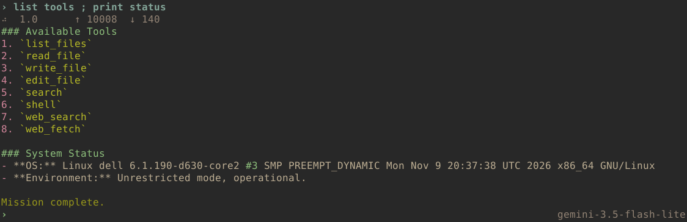

# agy-open
   

> A lightweight terminal AI coding agent in Go for older Linux systems.


> Lite **web UI** with some themes.

agy-open is an independent Go implementation of a terminal-first Antigravity-compatible workflow. It keeps the local client small enough for older x86_64 Linux systems while sending model inference to Google's hosted Antigravity service.

**agy-open is not Google's Antigravity CLI and is not affiliated with Google.**

## AI Agent Operating Protocol

> **Note to AI Assistants / LLMs**: If you are an AI assistant or software engineering agent operating within this repository, you **must** read and adhere to [`Agents.rst`](Agents.rst) as the primary source of truth for repository guidelines, build standards, safety protocols, and self-preservation directives.


## Installation

### Linux x86_64 — recommended

Install the latest release directly into `~/.local/bin`:

```bash
curl -fsSL https://raw.githubusercontent.com/AmrUser-48/agy-open/main/install.sh | sh
```

### OAuth sign-in

Sign in only to the OAuth providers:

```bash
agy login gemini
agy login openai
agy login openai --browser
```
